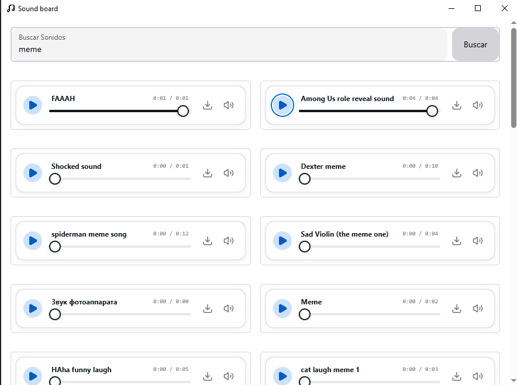

<div align="center">


# Sound Board

A desktop app to search and play sounds from [MyInstants](https://www.myinstants.com).
Search for any sound, listen to it instantly, and download it as an MP3.

[](https://github.com/Power2015Dev/Sound_board/releases/tag/1.0.0)




[](https://ko-fi.com/power2015#)

</div>

## Features

- **MyInstants search** right from the app, no browser needed.
- **Per-sound player** with a progress bar, duration and volume control.
- **One-click MP3 download.**
- **Native desktop app** for Windows (installer or portable).

## Download

Go to the [latest release](https://github.com/Power2015Dev/Sound_board/releases/latest) and download one of these files:

| File | Use it for |
| --- | --- |
| `Sound-Board-x.y.z-Setup.exe` | Installer. Adds shortcuts to the desktop and Start menu. |
| `Sound-Board-x.y.z-Portable.exe` | No installation needed. Just open it. |

> **Windows SmartScreen warning:** the app is not digitally signed, so Windows may show
> "Windows protected your PC". Click **More info → Run anyway**.

## How it works

```
React (renderer)  ──ipc: search-sounds──▶  Electron (main)  ──axios──▶  myinstants.com
       ▲                                         │
       └──────── list of {title, url} ◀──────────┘  (HTML parsed with cheerio)
```

The Electron main process fetches the MyInstants search results page, extracts each sound's
name and MP3 URL with **cheerio**, and sends them back to the React UI over IPC.
Downloads use `webContents.downloadURL`, so there are no CORS issues.

## Tech stack

- [Electron](https://www.electronjs.org/) + [electron-vite](https://electron-vite.org/)
- [React 19](https://react.dev/) + [NextUI](https://nextui.org/) + [Tailwind CSS](https://tailwindcss.com/)
- [axios](https://axios-http.com/) and [cheerio](https://cheerio.js.org/) for scraping
- [electron-builder](https://www.electron.build/) for packaging

## Development

Requirements: [Node.js](https://nodejs.org/) 20 or newer.

```bash
git clone https://github.com/Power2015Dev/Sound_board.git
cd Sound_board/Sound_board
npm install
npm run dev
```

### Build

| Command | Output |
| --- | --- |
| `npm run build:win` | Windows installer and portable in `Sound_board/dist/` |
| `npm run build:linux` | AppImage and .deb (run on Linux) |
| `npm run build:mac` | .dmg (run on macOS) |
| `npm run build:unpack` | Unpacked folder, handy for quick testing |

### Publishing a release

1. Bump `version` in `Sound_board/package.json` (for example `1.0.1`).
2. Commit, then create a tag with the same number:
   ```bash
   git push
   git tag v1.0.1
   git push origin v1.0.1
   ```
3. GitHub Actions builds the app on Windows and creates a **draft release** with the `.exe` files.
   Open *Releases*, review the draft and click **Publish release**.

## Project structure

```
Sound_board/
├── src/
│   ├── main/        # Main process: window, IPC and scraper
│   ├── preload/     # Secure bridge between Electron and React
│   └── renderer/    # React UI
├── build/           # Installer icons
└── electron-builder.yml
```

## Disclaimer

This project is not affiliated with MyInstants. All sounds belong to their respective owners;
the app only makes them easier to find and play. If MyInstants changes its website layout,
search may stop working until the scraper is updated.

## License

[MIT](LICENSE) © Power2015Dev
